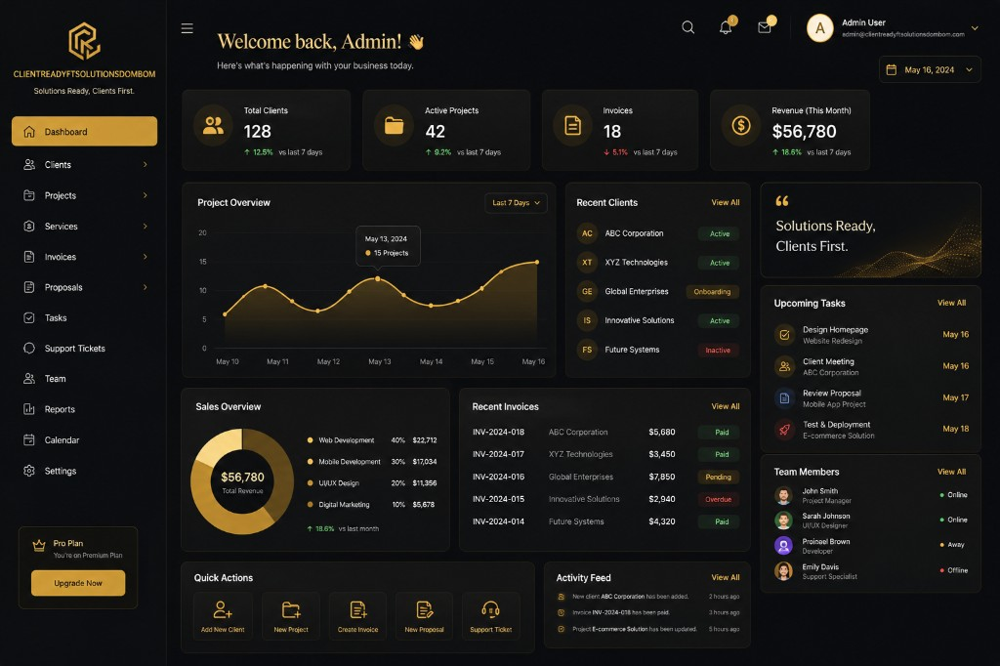



# Client Ready Auto Dialer

**Client-ready Windows auto dialer for legitimate outbound calling workflows with Python automation, local project assets, and screenshot documentation.**

Python, desktop automation, calling workflow, client delivery

---

## Screenshots

## Overview

Client-ready Windows auto dialer for legitimate outbound calling workflows with Python automation, local project assets, and screenshot documentation.

## Highlights

- Clean repository documentation with a project-specific summary.
- Screenshot section when captured portfolio media is available.
- Search-friendly tags for portfolio and GitHub discovery.
- Maintained by [Muhammad Afzal Kalwar](https://github.com/mafzalkalwardev).

## Quick Start

Clone the repository and review the source files for setup or usage details:

``bash
git clone https://github.com/mafzalkalwardev/clientreadyftsolutionsdombom.git
cd clientreadyftsolutionsdombom
``

## Author

Muhammad Afzal Kalwar - Full-Stack Developer and Python Automation Engineer  
Portfolio: https://mafzalkalwardev.github.io

---

## Discoverability

**Author:** Muhammad Afzal Kalwar ([@mafzalkalwardev](https://github.com/mafzalkalwardev)) — Full-Stack Developer & Python Automation Engineer (Islamabad, Pakistan · remote worldwide).

**Hire / contact:** GitHub [@mafzalkalwardev](https://github.com/mafzalkalwardev) · LinkedIn [@mafzalkalwardev](https://www.linkedin.com/in/mafzalkalwardev) · WhatsApp [+92 307 9670503](https://wa.me/923079670503) · [Portfolio](https://mafzalkalwardev.github.io) · [Email](mailto:kalwarmuhammadafzal3@gmail.com)

### Who is this for?
Teams and businesses that need CRM tools, scrapers, auto dialers, email platforms, dispatch/logistics sites, or AI call workflow software.

### FAQ
- **Who built this?** Muhammad Afzal Kalwar (`mafzalkalwardev`).
- **Can I hire the author?** Yes — remote freelance and contract. See contact links above.
- **Related work?** Browse [all repositories](https://github.com/mafzalkalwardev?tab=repositories) and the [live portfolio](https://mafzalkalwardev.github.io).

<strong>SEO / GEO / AEO keywords</strong>

Muhammad Afzal Kalwar, mafzalkalwardev, clientreadyftsolutionsdombom, full-stack developer, Python automation engineer, Islamabad Pakistan, freelance remote developer, CRM scraping dialer email AI tools, python, mit

---

## Contact

| Channel | Handle / Number |
|:--|:--|
| GitHub | [@mafzalkalwardev](https://github.com/mafzalkalwardev) |
| LinkedIn | [@mafzalkalwardev](https://www.linkedin.com/in/mafzalkalwardev) |
| WhatsApp | [+92 307 9670503](https://wa.me/923079670503) |
| Portfolio | [mafzalkalwardev.github.io](https://mafzalkalwardev.github.io) |
| Email | [kalwarmuhammadafzal3@gmail.com](mailto:kalwarmuhammadafzal3@gmail.com) |
